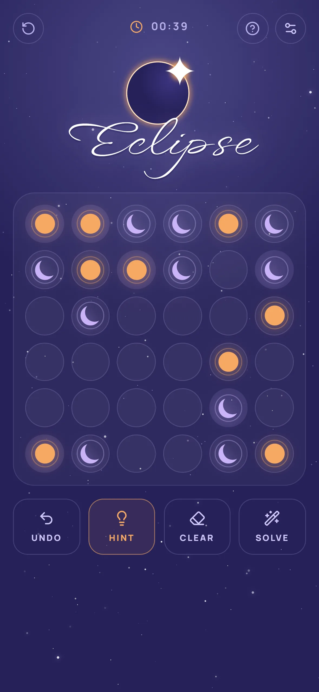
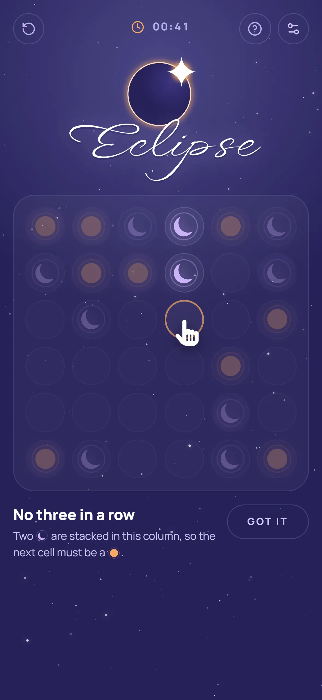
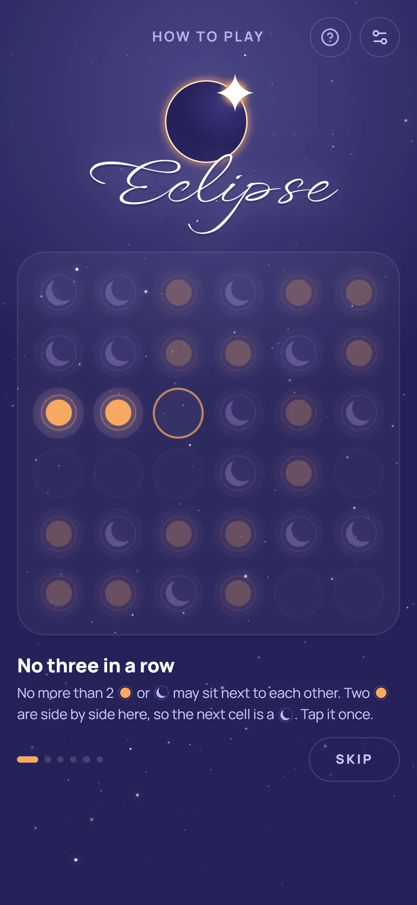
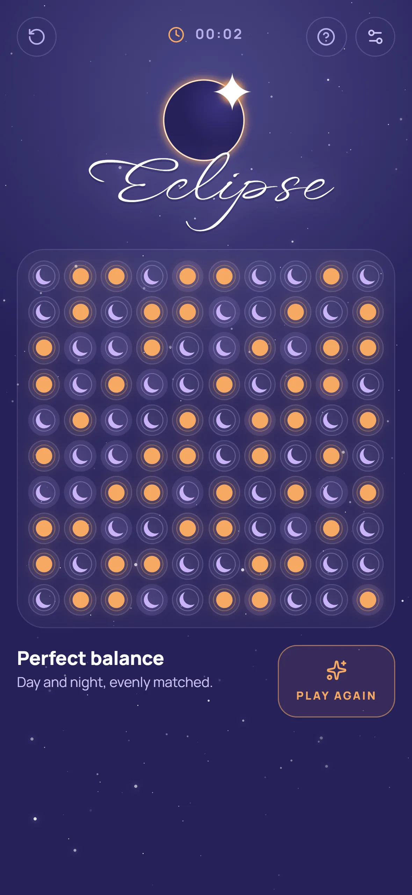

# Eclipse

A binary logic puzzle about duality: fill the grid with suns and moons until it is perfectly balanced. Part of Andromeda Games.

**Play:** https://eclipse.andromeda-games.com

<p align="center">
  
  
  
  
</p>

## How to play

Every cell holds either a sun or a moon.

- No more than two identical symbols may sit next to each other, horizontally or vertically.
- Each row and each column contains the same number of suns and moons.
- No two rows and no two columns are the same.

Every puzzle has exactly one solution and can be solved by deduction alone, so you never need to guess.

## Features

- **Three board sizes:** 6×6, 8×8 and 10×10.
- **Generated puzzles:** a fresh puzzle every game, built in a Web Worker and checked to have a unique solution.
- **Hints that explain themselves:** a hint points at the cells it relies on and names the rule behind the next move. If you made a mistake, it shows which rule your move breaks.
- **Interactive tutorial** for first-time players, available again from the rules.
- **Undo, clear and restart**, plus an optional timer.
- **Installable PWA** that works offline.

## Tech stack

Next.js 16, React 19, TypeScript 7, Zustand, Tailwind CSS 4, Motion, Radix UI, Vitest 5, oxlint.

## Development

Requires Node.js 26 (see `.nvmrc`) and pnpm 12.

```bash
pnpm install
pnpm dev        # http://localhost:3002
```

| Command          | What it does                  |
| ---------------- | ----------------------------- |
| `pnpm build`     | Production build              |
| `pnpm start`     | Serve the production build    |
| `pnpm test`      | Run tests with Vitest         |
| `pnpm lint`      | Lint with oxlint              |
| `pnpm typecheck` | Type-check with `tsc`         |

The code follows Feature-Sliced Design under `src/fsd`:

- `app`: root layout, Zustand stores, service worker registration.
- `pages/game`: game screen, puzzle model (generator, solver, hints) and its UI.
- `shared`: UI primitives, hooks and utilities.

## License

[MIT](LICENSE)
